# b8

A personal finance app I built for my own household — bank sync via Plaid, a composed net-worth statement covering cash, investments and real estate, envelope-style category budgets, and a chat assistant for asking questions about spending.

Built as a hobby project to get hands-on with a production-grade Plaid integration, an LLM tool-use agent loop, and a from-scratch (no ORM) Postgres data layer, alongside my main portfolio work (ZIA API Explorer, public MCP servers).

## Screenshots

> Every figure, account name, bank, merchant and address below is fabricated. The screenshots are
> generated from a synthetic dataset, never from real data.

| | |
|---|---|
| 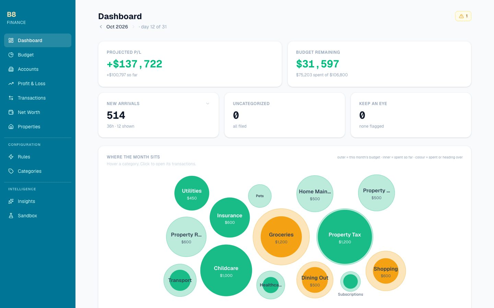 | 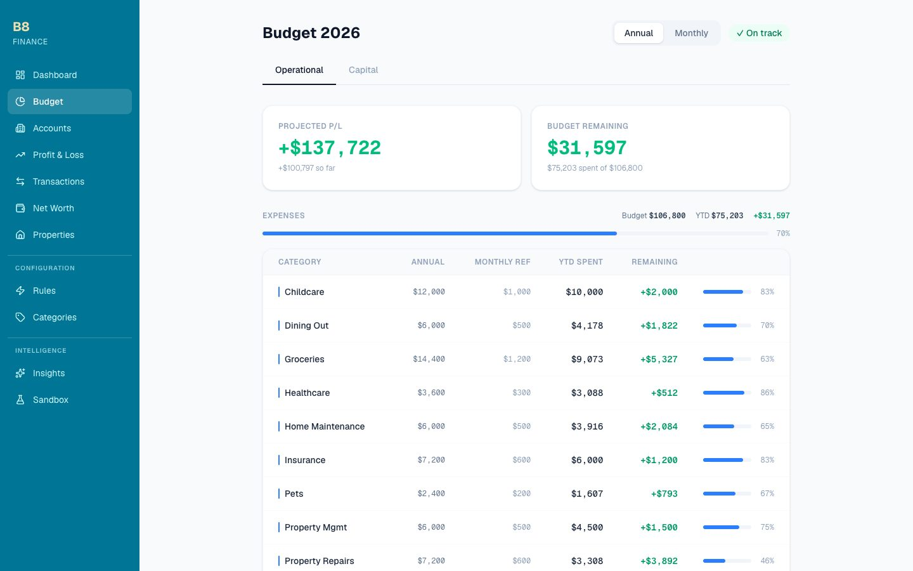 |
| **Dashboard** — the year-end target, what is waiting on you, and where each category sits this month | **Budget** — annual allocations, what is left, and the projected year end |
| 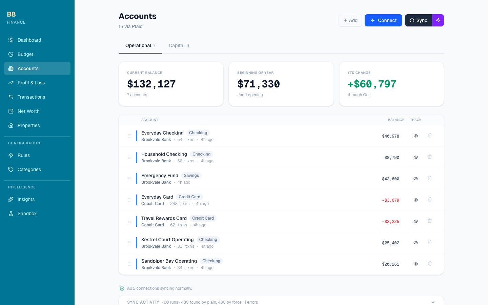 | 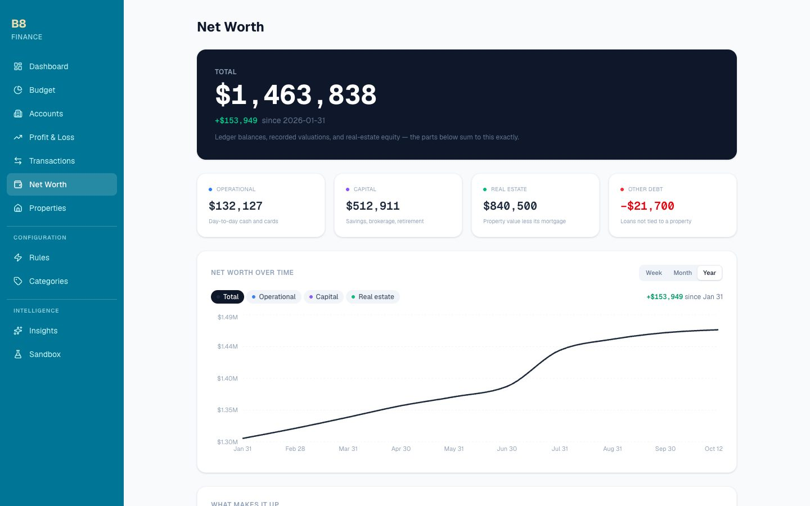 |
| **Accounts** — per landscape, with the year's opening and change | **Net worth** — four components that sum to the total, over a week, month or year |
| 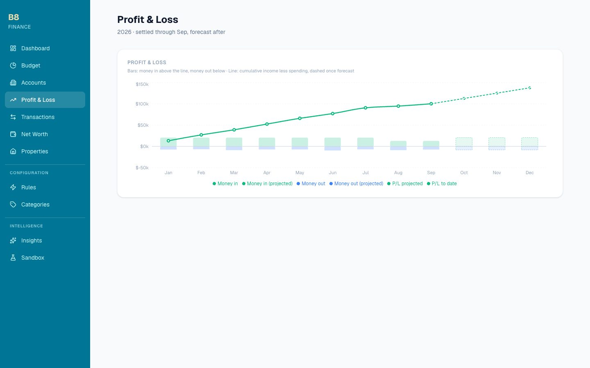 | 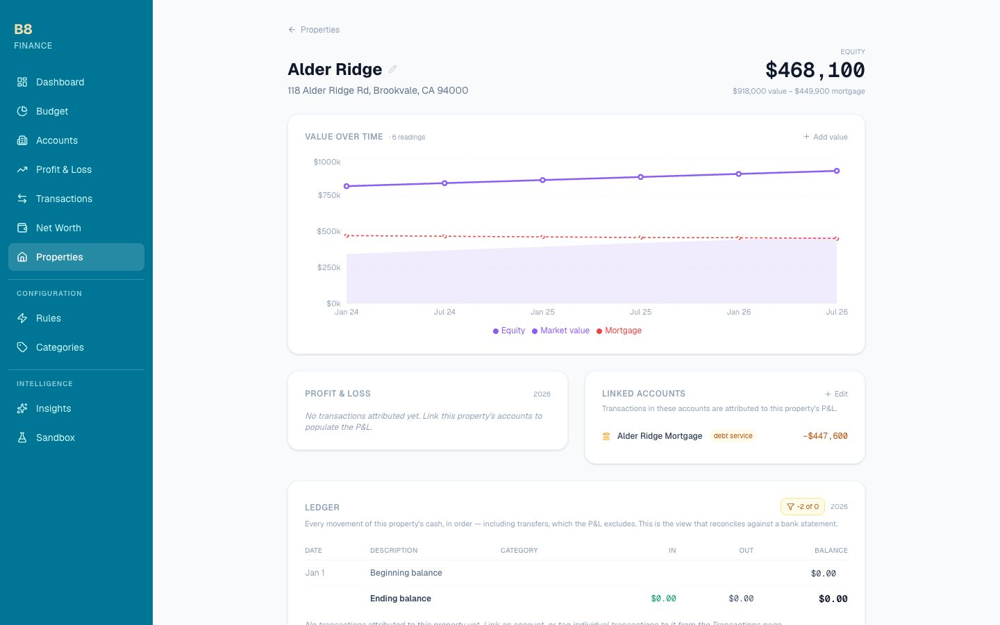 |
| **Profit & loss** — settled months, then the forecast to December | **Property** — value against mortgage over time, plus a per-property P&L |
| 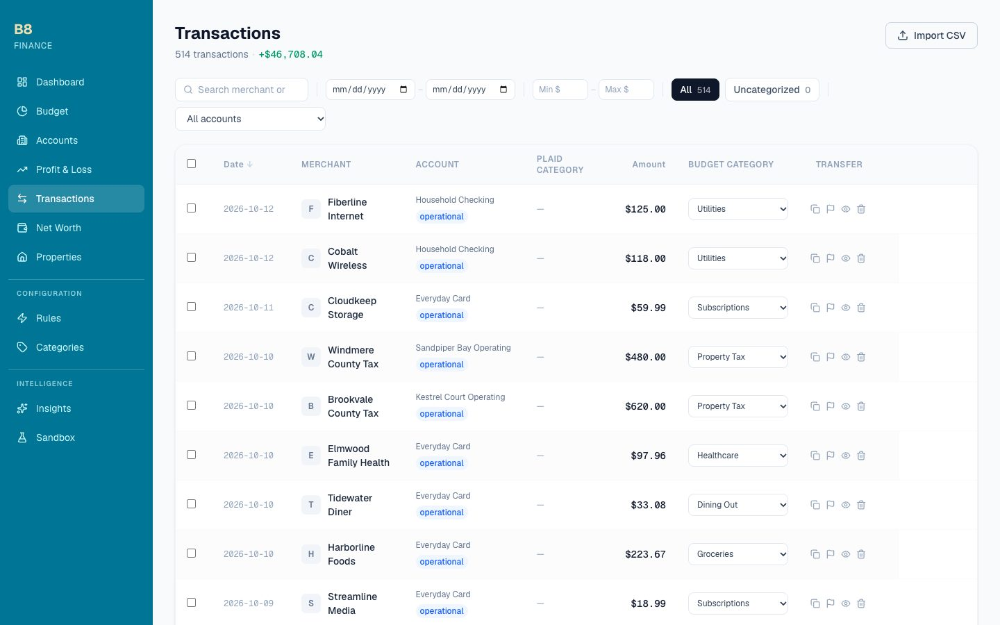 | |
| **Transactions** — the ledger, filed by rule or by hand | |

**On the phone** — installed to the Home Screen, which is how it is used day to day:

<p>
  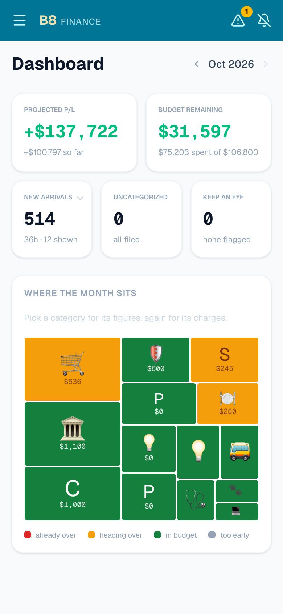
  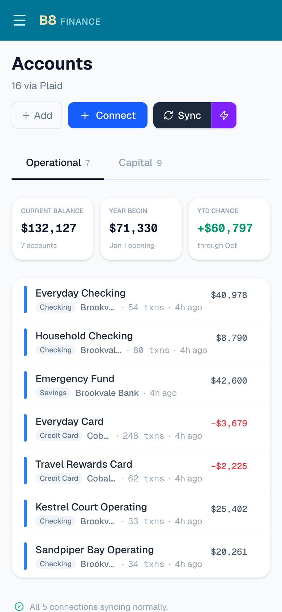
  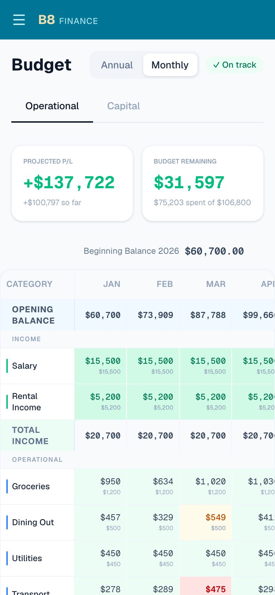
  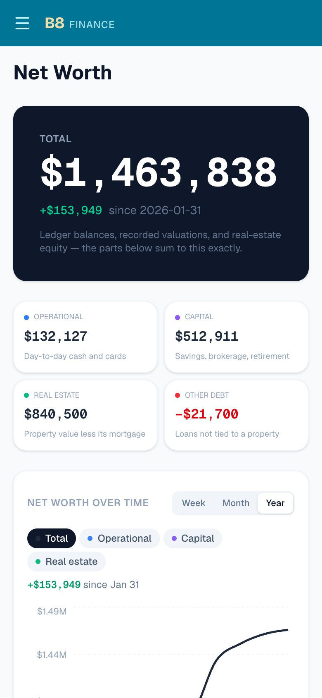
  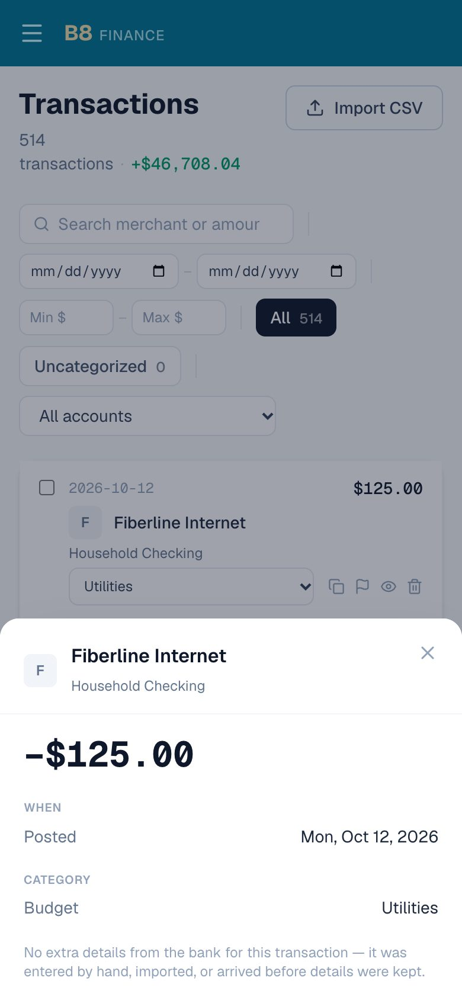
  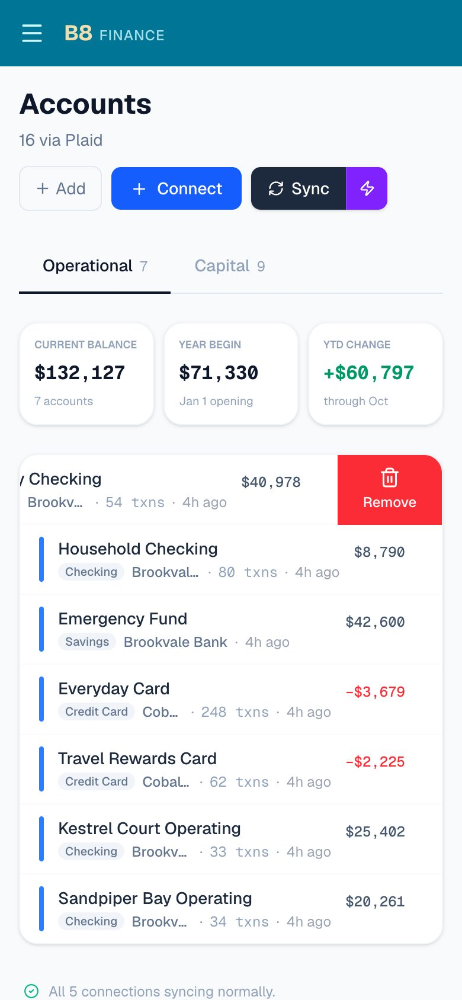
</p>

Dashboard · accounts · budget grid · net worth · a transaction's detail · swipe to remove

## Features

- **Net worth** — one figure composed of four non-overlapping components (operational cash, capital/financial, real-estate equity, other debt) that sum to the total exactly. A property-linked mortgage is counted only inside its property's equity, never also as a standalone liability, so the same debt can't be subtracted twice. Properties with no valuation on record are excluded and disclosed rather than silently valued at $0
- **Dual-regime balances** — every account is either *ledger* (beginning balance + Σ transactions) or *valuation* (the latest recorded figure). A brokerage has no meaningful transaction ledger; a checking account has no meaningful "valuation". Getting this wrong is why an investment account can sit contributing $0 to net worth indefinitely, so newly linked accounts are prompted for their mode at link time
- **Reconciliation** — the ledger balance is compared against what the bank reports, and accounts that disagree are surfaced. Accounts that were never given an opening balance can be reconciled in one click; accounts that *had* one and have since diverged deliberately are not, because there the gap is evidence of a missing or duplicated transaction and moving the opening figure would bury it
- **Real estate** — per-property valuation history, equity charted as the gap between market value and the mortgage balance *as of that date*, and a per-property P&L separating operating expenses from debt service
- **Bank sync** — Plaid Link to connect accounts, incremental sync via `transactionsSync` with a cursor, pending-transaction handling to avoid duplicate postings, a daily scheduled sync, and per-connection staleness reporting (the unit that actually fails and that re-auth applies to is the Plaid Item, not the account)
- **Budgets** — per-category annual budgets with an optional month-by-month allocation schedule (for categories that aren't evenly spread across the year), status thresholds, and a monthly grid view
- **Transactions** — search/filter by amount range, account, and category; auto-categorization rules mapping Plaid categories to budget categories; manual duplication/editing for corrections; CSV import for accounts Plaid can't reach
- **Accounts** — drag-and-drop ordering, editable type/balance, relinking after a Plaid reconnect (accounts are matched back to their transaction history by `persistent_account_id`/mask rather than treated as new, and re-issued transaction IDs are matched back to the rows they replace rather than inserted as duplicates)
- **Insights & balances** — top merchants, monthly spending trends, per-account/category running balances
- **Chat assistant** — an Anthropic-powered agent with read-only tools (budget summary, monthly spending, top merchants, transaction lookup) for asking natural-language questions about your own data

## Design notes

- **Pure core, I/O shell.** The money logic — net-worth composition, drift detection, property equity, Plaid account/transaction matching, sync-health classification — lives in `apps/web/lib/domain/*` as pure functions with no database access, and the query that feeds each one sits at the call site. That is what makes the arithmetic testable without a database, and it is why the test suite runs in under a second
- **Derived reads, not stored columns.** Balances, equity and drift are computed at read time from data that is already persisted. A stored copy would only ever be a cache that goes stale between syncs

## Stack

- Next.js 16 (App Router) · React 19 · TypeScript
- PostgreSQL via raw `pg` — no ORM, hand-written parameterized SQL
- Plaid API (production)
- Anthropic SDK (tool-use agent loop)
- Tailwind CSS

## API versioning

Not versioned today — every `/api/*` route is called only by this app's own frontend, not by any consumer outside this repo, so there's no compatibility contract to protect yet. If that changes (a public MCP server, a mobile client, anything external depending on response shapes), the convention is an `/api/v1/` prefix on the routes exposed to that consumer, added at that point rather than pre-emptively; the existing unprefixed `/api/*` routes stay as-is as the internal-only surface.

## Running locally

This is a single-user, self-hosted app — it expects to be run for one person's own accounts, not deployed as a multi-tenant service.

1. `npm install`
2. Create a Postgres database (with the `pgvector` extension available — see `db/schema.sql`'s note on building it from source against Postgres 16 on Homebrew)
3. Copy `.env.local.example` to `.env.local` and fill in your own Plaid, database, and Anthropic API credentials
4. `npm run migrate:up` — applies `migrations/` via `node-pg-migrate`, reading `DATABASE_URL` from the environment (`db/schema.sql` is kept as a human-readable reference of the same schema; the migrations are the source of truth)
5. `npm run dev`

The dev/start scripts bind to `127.0.0.1` only.

## Running via Docker

An alternative to the steps above — app + Postgres (with `pgvector`) in containers, no local Postgres install needed:

1. Copy `.env.local.example` to `.env.local`, fill in your credentials, and also set `POSTGRES_PASSWORD` (used only by the `db` container)
2. `npm run docker:up` — builds the app image, starts Postgres, runs migrations, then starts the app on `127.0.0.1:3000`
3. `npm run docker:down` to stop

Ports are published to `127.0.0.1` only, matching the dev/start scripts' own localhost-only binding.

## Note on data

This repo contains only application code and schema — no real account data, transactions, or credentials. All of that lives in a local Postgres database and a gitignored `.env.local`, neither of which is part of this repository.

That includes the screenshots above. They are taken from a wholly synthetic dataset in a throwaway database — so every balance, bank, merchant, property and address shown is invented. Street and city names are fictional and the postal codes are deliberately invalid.

### Regenerating the screenshots

One command, from `apps/web`:

```sh
npm run screenshots
```

`scripts/screenshots.mjs` creates its own scratch database (`b8_screens`), migrates it, fills it with `scripts/seed-demo.mjs`'s fabricated data, mints a test session, starts the dev server against it, and drives headless Chrome over the DevTools protocol to write every image in `docs/screenshots/` — desktop at 1440×900 and the phone at 390×844 in installed-app mode. It then drops the database. It never reads `DATABASE_URL` from the environment or `.env.local`, so it cannot touch a real ledger.

The seed is anchored to the day it runs, so the figures always look current; look over every image before committing all the same.

`seed-demo.mjs` can also fill a database of your own choosing for poking around. **It truncates every table first**, so it refuses to run without an explicit flag — point it at a scratch database, never at a real one:

```sh
createdb b8_demo && DATABASE_URL=postgresql://localhost/b8_demo npx node-pg-migrate up
DATABASE_URL=postgresql://localhost/b8_demo npm run seed:demo -- --yes-wipe-my-database
```
